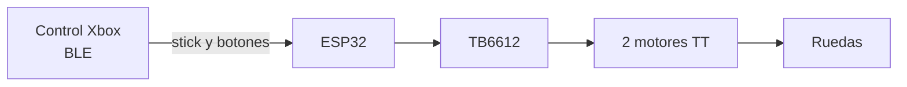

# Proyecto 1 · Carro a control remoto por Bluetooth

## 1. ¿De qué trata el proyecto?

Nuestro reto fue construir entre todos un carro que se maneje por Bluetooth. En nuestro caso lo controlamos con un **control de Xbox** conectado directo al ESP32 por Bluetooth Low Energy (BLE). Para hacerlo juntamos lo que hemos visto en el curso: electrónica, el microcontrolador, los actuadores, la comunicación y los mecanismos. Al final todos los carros se enfrentan en un torneo de fútbol RC 1v1.

Este carro no es solo para este proyecto. Lo vamos a reutilizar en el Proyecto Final, así que lo diseñamos pensando en quitarle el control humano y volverlo autónomo con visión por computadora.

### Responsables por área

| Área | Responsable |
|------|-------------|
| Mecánica / chasis | Mario |
| Electrónica / alimentación | Mariel/Mafer |
| Programacion | Mauro |


### Cómo funciona (diagrama en bloques)



---

## 2. Requisitos y cómo los cumplimos

| # | Requisito | Cómo lo resolvimos | ¿Cumple? |
|---|-----------|--------------------|----------|
| R1 | Moverse adelante, atrás, izquierda, derecha y alto | Con el stick izquierdo del control. Si el stick está en el centro, el carro se detiene. | Cumple con el objetivo, pero se podrian hacer modificaciones a futuro. |
| R2 | Control de velocidad con PWM (mínimo 3 niveles) | Tres velocidades fijas con los botones A, B y X (170, 210 y 255 de 255). | Cumple con lo requerido |
| R3 | Failsafe: se detiene solo si se pierde el enlace | Si el ESP32 detecta que el control no está conectado, apaga los dos motores. | Cumple con lo necesario  |
| R4 | Interruptor físico de encendido/apagado accesible | Se coloco en la parte posterior del carro | Funciono correctamente |
| R5 | Motores con alimentación separada del ESP32 (GND común) | Los motores fueron conectados de una manera facil | Funcionaron de la manera correcta  |
| R6 | Cableado ordenado y sujeto | Todo fue conectado mediante jumpers, y cables para conectar directo en la protoboard | Funcionaron las conecciones, solo durante un momento donde tuvo un movimiento brusco el auto, se movio parte de las conecciones |
| R7 | Superficie plana de mínimo 6 × 6 cm arriba (para el ArUco del Proyecto Final) | tuvo la medida requerida y de medida total estuvo dentro del limite permitido | 20 cm |
---

## 3. Controles (protocolo)

En lugar de mandar comandos de texto, el ESP32 lee directamente el estado del control de Xbox.

| Control | Acción |
|---------|--------|
| Stick izquierdo hacia arriba | Adelante |
| Stick izquierdo hacia abajo | Atrás |
| Stick izquierdo hacia la derecha | Giro a la derecha (el carro gira sobre su propio eje) |
| Stick izquierdo hacia la izquierda | Giro a la izquierda (el carro gira sobre su propio eje) |
| Stick en el centro | Alto |
| Botón **A** | Velocidad lenta (170) |
| Botón **B** | Velocidad media (210), es la que usa al encender |
| Botón **X** | Velocidad rápida (255) |

**Zona muerta:** el stick tiene que moverse más allá del 40 % para que el carro responda. Así evitamos que se mueva solo por el pequeño desajuste del stick.

**Failsafe:** si el control se desconecta, el ESP32 apaga los motores y espera a que se vuelva a conectar.

---

## 4. Lista de materiales (BOM)

| Componente | Cantidad | Costo aprox. | ¿Comprado, prestado o reutilizado? |
|------------|----------|--------------|------------------------------------|
| ESP32 DevKit V1 | 1 | $[ ] | [ ] |
| Driver TB6612 | 1 | $[ ] | [ ] |
| Motor | 2 | $[ ] | [ ] |
| Control de Xbox | 1 | $[ ] | [ ] |
| Baterías / portapilas | [ ] | $[ ] | [ ] |
| Interruptor | 1 | $[ ] | [ ] |
| Chasis | 1 | $[ ] | [ ] |
| **Total** | | **$[ ]** | |

---

## 5. Conexiones

| Pin ESP32 | Conectado a | Para qué sirve |
|-----------|-------------|----------------|
| GPIO 17 | AIN1 | Dirección del motor izquierdo |
| GPIO 16 | AIN2 | Dirección del motor izquierdo |
| GPIO 23 | PWMA | Velocidad del motor izquierdo |
| GPIO 19 | BIN1 | Dirección del motor derecho |
| GPIO 18 | BIN2 | Dirección del motor derecho |
| GPIO 22 | PWMB | Velocidad del motor derecho |
| GPIO 21 | STBY | Standby del driver (tiene que estar en HIGH para que funcione) |
| GND | GND común | Tierra compartida con la batería de los motores |

---

## 6. Código

```cpp
#include <Arduino.h>
#include <BLEGamepadClient.h>

// Motor izquierdo (canal A del TB6612)
#define nAlto 17   // AIN1
#define nBajo 16   // AIN2
#define pwma  23   // PWMA
// Motor derecho (canal B del TB6612)
#define rAlto 19   // BIN1
#define rBajo 18   // BIN2
#define pwmb  22   // PWMB
// Standby (debe estar en HIGH, o conectado a 3.3V)
#define STBY  21
// =====================================================

const bool ARRIBA_ES_POSITIVO = true;

// ----- Velocidades (botones A, B y X) -----
const int velA = 170;   // botón A: lenta
const int velB = 210;   // botón B: media
const int velX = 255;   // botón X: rápida
int vel = velB;

const float ZONA = 0.4;

XboxController controller;

// dir: 1 = adelante, -1 = atrás, 0 = alto
void motorIzq(int dir) {
  digitalWrite(nAlto, dir == 1  ? HIGH : LOW);
  digitalWrite(nBajo, dir == -1 ? HIGH : LOW);
  ledcWrite(pwma, dir == 0 ? 0 : vel);
}

void motorDer(int dir) {
  digitalWrite(rAlto, dir == 1  ? HIGH : LOW);
  digitalWrite(rBajo, dir == -1 ? HIGH : LOW);
  ledcWrite(pwmb, dir == 0 ? 0 : vel);
}

void alto() {
  motorIzq(0);
  motorDer(0);
}

void setup() {
  pinMode(rAlto, OUTPUT);
  pinMode(rBajo, OUTPUT);
  pinMode(nAlto, OUTPUT);
  pinMode(nBajo, OUTPUT);
  pinMode(STBY, OUTPUT);
  digitalWrite(STBY, HIGH);

  // PWM a 1 kHz, 8 bits (core ESP32 3.x)
  ledcAttachChannel(pwma, 1000, 8, 0);
  ledcAttachChannel(pwmb, 1000, 8, 1);

  alto();               // arranca detenido
  controller.begin();
}

void loop() {
  int adelante = 0, atras = 0, dere = 0, izq = 0;

  // FAILSAFE: sin control conectado -> detener
  if (!controller.isConnected()) {
    alto();
    delay(20);
    return;
  }

  XboxControlsState s;
  controller.read(&s);

  float ejeY = s.leftStickY;
  float ejeX = s.leftStickX;

  // Stick arriba = adelante, stick abajo = atrás
  if (ARRIBA_ES_POSITIVO) {
    if (ejeY >  ZONA) adelante = 1;
    if (ejeY < -ZONA) atras = 1;
  } else {
    if (ejeY < -ZONA) adelante = 1;
    if (ejeY >  ZONA) atras = 1;
  }

  // Stick a la derecha / izquierda
  if (ejeX >  ZONA) dere = 1;
  if (ejeX < -ZONA) izq = 1;

  // Botones A, B y X: velocidad
  if (s.buttonA) vel = velA;
  if (s.buttonB) vel = velB;
  if (s.buttonX) vel = velX;

  // Movimiento
  if (adelante) {
    motorIzq(1);  motorDer(1);
  } else if (atras) {
    motorIzq(-1); motorDer(-1);
  } else if (dere) {          // izquierda avanza, derecha retrocede
    motorIzq(1);  motorDer(-1);
  } else if (izq) {           // derecha avanza, izquierda retrocede
    motorIzq(-1); motorDer(1);
  } else {
    alto();
  }

  delay(20);
}
```

### Cómo funciona el código

**1. Librería y pines.** Usamos `BLEGamepadClient`, que permite que el ESP32 se conecte como cliente BLE a un control de Xbox. Con los `#define` le ponemos nombre a cada pin del TB6612 para no memorizar números.

**2. Constantes de configuración.**
- `ARRIBA_ES_POSITIVO`: si el stick da valores invertidos (arriba negativo), se cambia a `false` y no hay que tocar nada más.
- `velA`, `velB` y `velX`: las tres velocidades. Son valores de PWM de 0 a 255.
- `vel`: guarda la velocidad actual. Empieza en la media.
- `ZONA`: la zona muerta del stick (0.4).

**3. `motorIzq()` y `motorDer()`.** Cada una recibe una dirección: `1` adelante, `-1` atrás y `0` alto. Con los dos pines de dirección (por ejemplo AIN1 y AIN2) se decide hacia dónde gira el motor: uno en HIGH y el otro en LOW. Con `ledcWrite` se manda el PWM que fija la velocidad. Si la dirección es `0`, el PWM se pone en 0.

**4. `alto()`.** Detiene los dos motores. La usamos al arrancar, cuando el stick está en el centro y en el