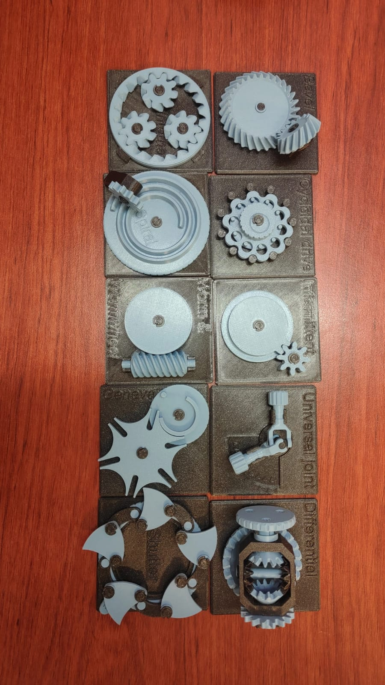
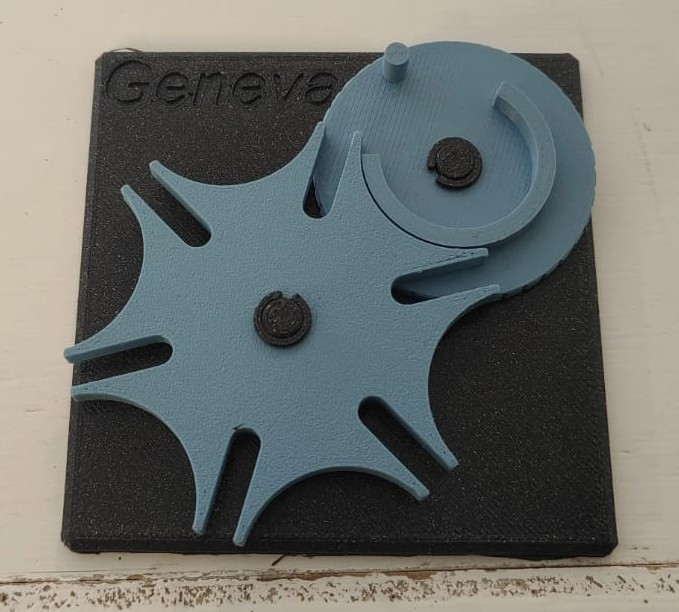
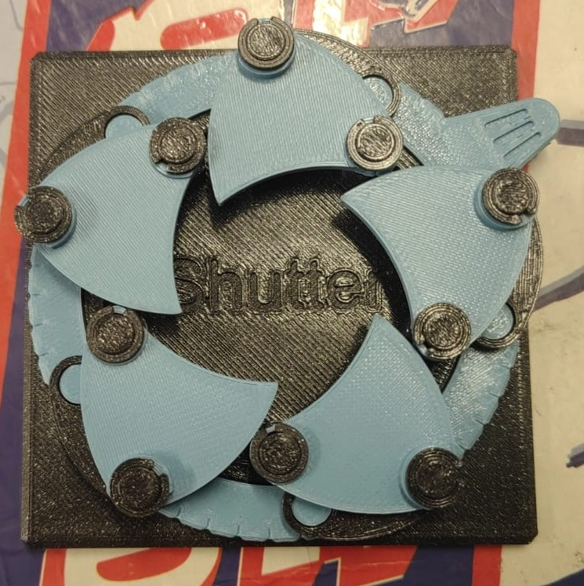
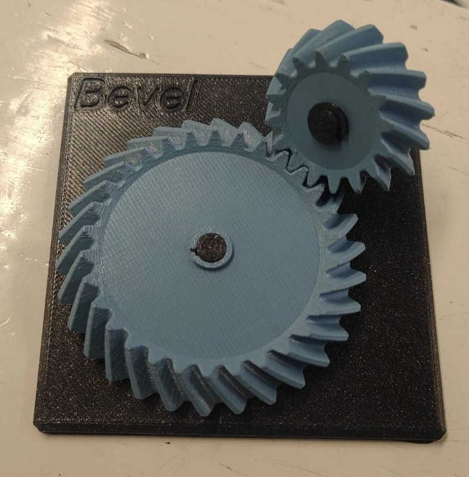

# Sesión 5 - Tipos de Mecanismos 
## 2026/09/18
## Mauro Guzmán Morales
# Sesión 5- Mecanismos 
## Qué deberíamos lograr hoy

En la sesión de hoy deberiamos identificar y entender cómo los mecanismos transforman el movimiento (velocidad ↔ par, rotación ↔ traslación, continuo ↔ intermitente) 

---
* **Objetivos**
 Comprender cómo funcionan los mecanismos al modificar la velocidad y la fuerza del movimiento, convertir el giro en desplazamiento lineal y generar movimientos continuos o intermitentes. Además, calcular relaciones de transmisión básicas y reconocer su funcionamiento en el sistema de transmisión de un automóvil mediante prácticas con mecanismos reales en un taller por estaciones.

 ## ¿Qué use?
 Durante esta sesion se usaron varios modelos impresos 3D como algunos de estos modelos 
 
 * Diferencial 
 * Reductor Cicloidal
 * Junta Cardán 
 * Obturador de laminas 
 * Transformar el movimiento
 * Redirigir y reducir
 
 
---
# Estaciones de mecanismos

| Estación | ¿Qué transforma? (vel/par, rot/trasl, continuo/intermitente, cambio de eje) | Relación i estimada (cuenta dientes o vueltas) | ¿Reversible o autobloqueante? | ¿Dónde lo has visto en la vida real? | ¿Dónde serviría en el carro o en un proyecto tuyo? |
|-----------:|:------------|:-----------:|:------------|:------------|:------------|
| A · Diferencial | Cambia la dirección del giro 90° y reparte la velocidad y la fuerza entre dos salidas, así cada rueda puede girar a distinta velocidad. | Conté los dientes y me dio entre 3 a 1 y 4 a 1, dependiendo del piñón y la corona. | Es reversible, se puede mover desde cualquiera de los dos lados. | Lo he visto en el eje de atrás de los carros de tracción trasera y en los 4x4. | Me serviría en el eje trasero de un carro a escala o para mover las ruedas de un robot que tenga que dar vueltas. |
| B · Reductor cicloidal | Baja mucho la velocidad y sube la fuerza, y lo hace con mucha precisión. | Con una sola etapa llega a una relación muy alta, de unos 30 a 1 hasta 100 a 1 o más. | Casi no se deja regresar, así que es autobloqueante o por lo menos le cuesta mucho girar al revés. | Se usa en las articulaciones de brazos robóticos de fábrica y en máquinas CNC. | Lo usaría en la articulación de un brazo robótico o en un proyecto donde necesite mover algo con mucha precisión. |
| C · Junta cardán (universal) | Pasa el giro de un eje a otro aunque no estén alineados, con un ángulo que puede cambiar. | Es 1 a 1, pero si el ángulo es grande la velocidad se vuelve irregular por momentos. | Es reversible. | La vi en la flecha larga que va debajo de los carros de tracción trasera y de las camionetas 4x4. | Serviría para unir dos ejes que no quedan derechos entre sí, por ejemplo en un prototipo de vehículo o en un banco de pruebas. |
| D · Obturador de láminas (leaf shutter) | Convierte un movimiento de giro en uno que abre y cierra por momentos, no continuo. | Cambia según cómo estén hechas las levas o las varillas, no tiene un valor fijo. | Depende del mecanismo, pero muchas veces es autobloqueante si lleva levas especiales. | Lo vi en el diafragma de las cámaras fotográficas y en persianas automáticas. | Lo pondría en las compuertas de ventilación o calefacción del carro, o en algo que tenga que soltar una cantidad medida de material. |
| E1 · Engrane intermitente y Espiral de Arquímedes | El engrane intermitente convierte un giro continuo en uno que avanza por pasos. La espiral convierte un giro parejo en un movimiento lineal que depende del ángulo. | Depende de cuántos pasos o dientes activos tenga el mecanismo. | Depende de la forma geométrica que tenga cada uno. | Lo he visto en relojes mecánicos, contadores y cajas de música. | Me serviría para mover piezas paso por paso, para contar cosas o para repartirlas de forma automática. |
| E2 · Engrane interno helicoidal y Sinfín multi-hilo + corona | Baja la velocidad y sube la fuerza, y además cambia el giro 90 grados. | Es una relación alta, que se saca contando los hilos del sinfín y los dientes de la corona. | Casi siempre es autobloqueante cuando el que mueve es el sinfín. | Se usa en la dirección de carros antiguos, en tornos de carga y en sistemas para levantar cosas. | Lo usaría en sistemas de elevación, malacates o cualquier cosa que deba quedarse bloqueada sin gastar energía. |

---

## Imagenes de modelos 3D

---

---

---
## ¿Que aprendi?
Durante esta sesion aprendi cómo funcionan los diferentes mecanismos y cómo los engranajes permiten transmitir y modificar el movimiento, la velocidad y la fuerza. También comprendí su importancia en sistemas mecánicos reales, como ejemplo seria en la transmisión de un automóvil.

## Siguente paso 
Completar la columna de la tabla de estaciones y identificar los diferentes mecanismos y en que manera se pueden implementar en la vida cotidiana. 